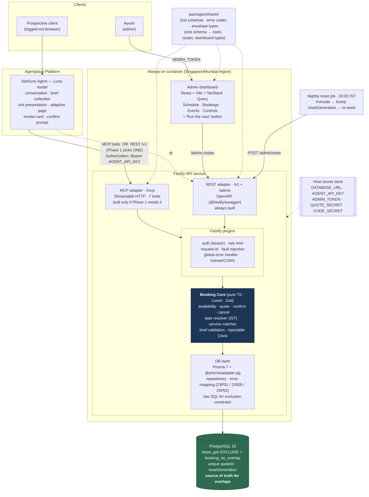
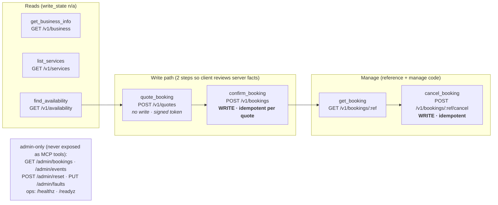
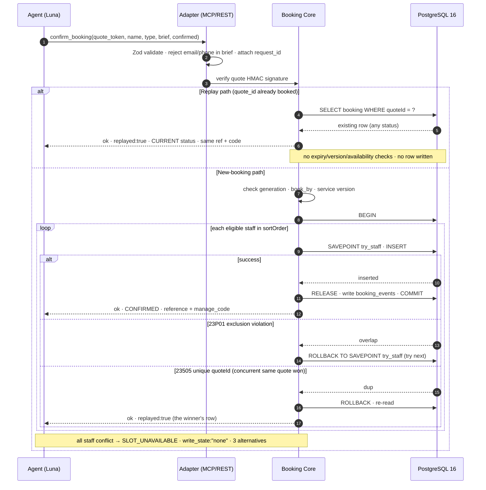
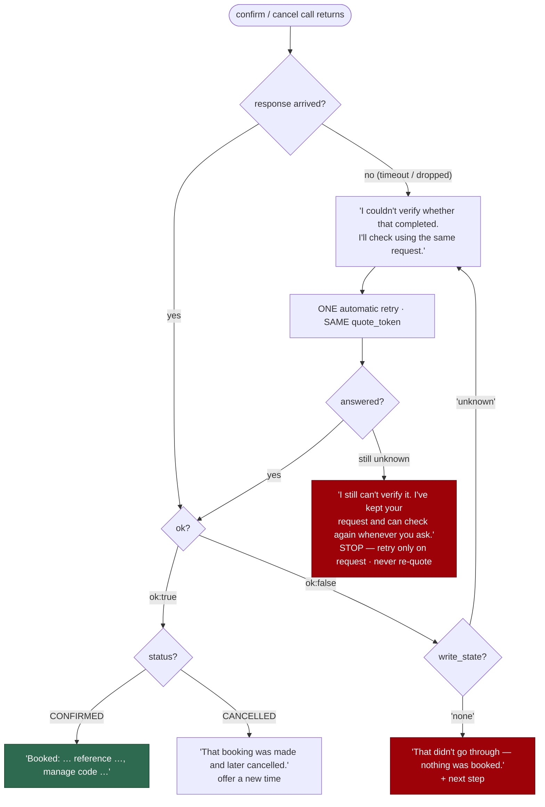
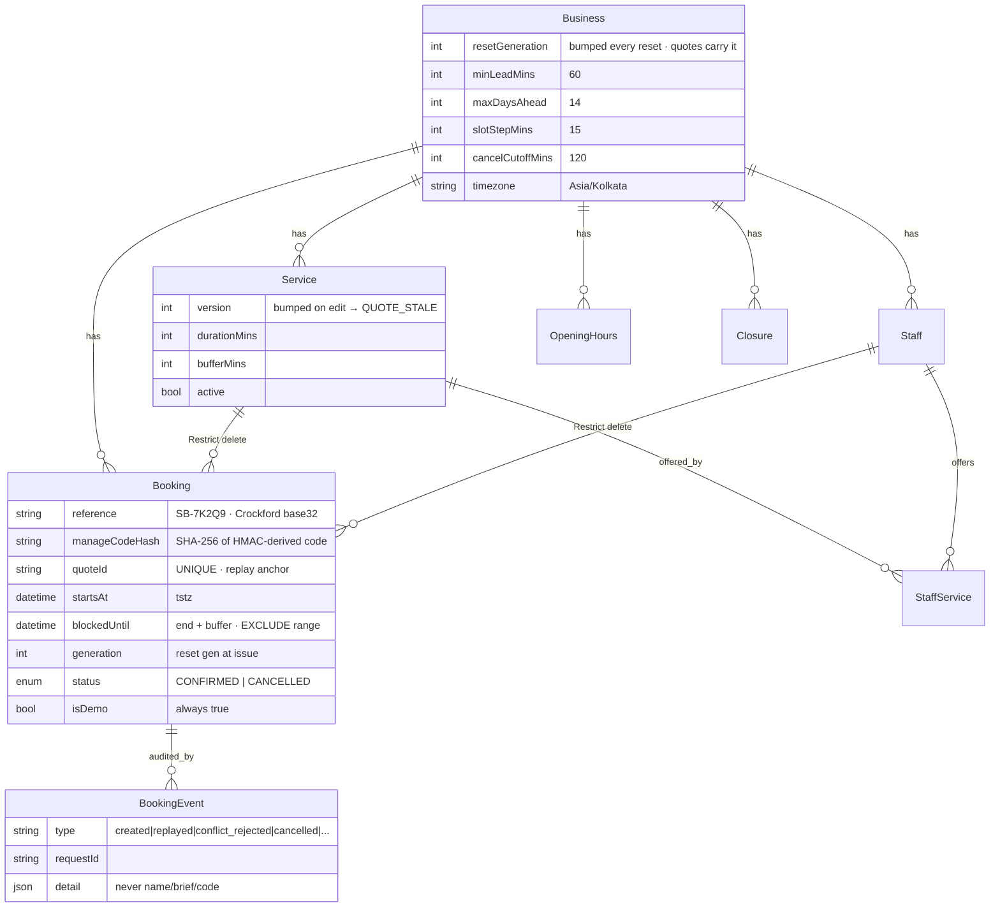
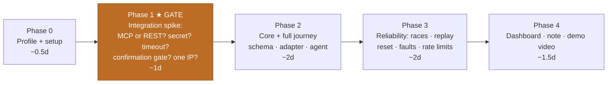
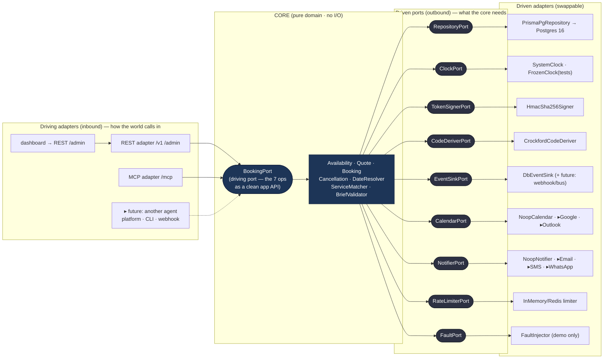
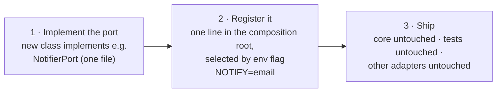

# SlotSure — Architecture Diagrams

Companion to **Agentplace Booking Agent — Build Spec.md**. Render with any Mermaid-capable
viewer (VS Code Mermaid preview, GitHub, mermaid.live).

Guiding principle: **the model talks, the API decides.** One booking core owns every rule;
only Postgres has the final word on overlaps.

**Architectural style: ports & adapters (hexagonal).** The core depends on *interfaces only* —
never on Fastify, Prisma, Agentplace, a calendar vendor or a notifier. Everything concrete is
an adapter plugged into a port at the composition root. A new integration is a new adapter
behind an existing port; the core never changes. See **§7 Extensibility** and **design-system.md**.

---

## 1. System architecture (one core, two adapters)



**Reading it:** the agent reaches the core through whichever single connection Agentplace
supports (MCP *or* REST — decided in Phase 1). The dashboard always uses REST `/admin`.
Both adapters call the identical core; only the core touches Postgres; the exclusion
constraint is the last line of defence against overlaps.

---

## 2. The 7 operations (quote-then-confirm write path)



---

## 3. Confirm booking — the reliability story (sequence)



---

## 4. Outcome decision — what the agent says (write_state)



---

## 5. Data model (key relations + constraints)



**The constraint that does the real work:**

```sql
CREATE EXTENSION IF NOT EXISTS btree_gist;
ALTER TABLE "Booking" ADD CONSTRAINT booking_no_overlap
  EXCLUDE USING gist (
    "staffId" WITH =,
    tstzrange("startsAt", "blockedUntil", '[)') WITH &&
  ) WHERE (status = 'CONFIRMED');
```

`WHERE status = 'CONFIRMED'` → a cancelled booking frees its slot instantly.
`[)` half-open range → a 10:00–10:30 booking sits flush against a 10:30 one.

---

## 6. Build phases (Phase 1 is a hard gate)



Phase 1 decides the agent-facing adapter, secret handling, and the confirmation strategy —
everything downstream depends on what the platform can actually do. Only the adapter that
works gets kept.

---

## 7. Extensibility — ports & adapters (loose coupling)

The whole system is built so that **adding an integration never touches the core**. The core
is a pure domain that speaks only to *ports* (TypeScript interfaces in `packages/shared`).
Concrete tech lives in *adapters*. A composition root (the **integration registry**) wires
adapters to ports from config at startup. Swap Postgres for something else, add a real
calendar, add WhatsApp, add a second agent platform — each is one new adapter + one registry
line. Nothing else moves.



### The ports (stable contracts)

| Port | Core needs it for | Demo adapter | Future adapters (drop-in) |
| --- | --- | --- | --- |
| `BookingPort` (driving) | the 7 operations as one app-level API | — (called by adapters) | — |
| `RepositoryPort` | persist & read bookings/events; run the race-safe tx | `PrismaPgRepository` | any SQL store with range-exclusion |
| `ClockPort` | resolve "now" in IST; freeze in tests | `SystemClock` / `FrozenClock` | — |
| `TokenSignerPort` | sign & verify quote tokens | `HmacSha256Signer` | KMS-backed signer, versioned keys |
| `CodeDeriverPort` | derive/verify manage codes | `CrockfordCodeDeriver` | versioned-key deriver |
| `EventSinkPort` | emit audit/domain events | `DbEventSink` | webhook, Kafka/NATS, analytics |
| `CalendarPort` | reflect a booking on a real calendar | `NoopCalendar` (demo-safe) | Google, Outlook, CalDAV |
| `NotifierPort` | confirm/cancel notifications | `NoopNotifier` (demo-safe) | Email, SMS, WhatsApp |
| `RateLimiterPort` | throttle reads/writes & code guesses | in-memory | Redis (multi-instance) |
| `FaultPort` | inject latency/503/fail-after-commit | `FaultInjector` | no-op in prod |

> The demo's `Noop` calendar/notifier adapters are what enforce the spec's **demo-safety rule**
> ("nothing touches a real calendar, no message is sent"). Turning the product real later is
> literally swapping two no-op adapters for real ones — the booking logic is untouched.

### Adding an integration — the whole procedure



Three rules keep it frictionless and enforce the coupling boundary:

1. **Dependency direction is one-way.** `core` imports from `packages/shared` (ports/types) only.
   It must never import `apps/api` adapters, Fastify, or Prisma. An ESLint
   `no-restricted-imports` / import-boundary rule fails the build if it does.
2. **The registry is the only wiring place.** `apps/api/src/composition.ts` reads env and binds
   each port to one adapter. Nothing else constructs adapters. Feature flags
   (`CALENDAR=noop|google`, `NOTIFY=none|email`, `STORE=postgres`, `LIMITER=memory|redis`)
   choose at boot; tests bind fakes the same way.
3. **Contracts live once.** Every port and every envelope is a Zod schema in `packages/shared`,
   so an adapter that drifts from the contract fails type-check, and the dashboard/tool schemas
   stay in lockstep automatically.

This is why "new integrations are smooth": the blast radius of any integration is exactly one
adapter file and one registry line.

---

## 8. Design system

The UI (admin dashboard now, agent adaptive page later) is **strictly token-driven** and
follows **design-system.md** — a **dark command-center** aesthetic, intentionally *not* the
BusinessNext brand. Single source of truth: `packages/shared/design/tokens.ts` → consumed as
CSS variables and a Tailwind preset. No component hardcodes a hex value; a lint rule forbids
raw colors outside the tokens file. See **design-system.md** for the full spec.
